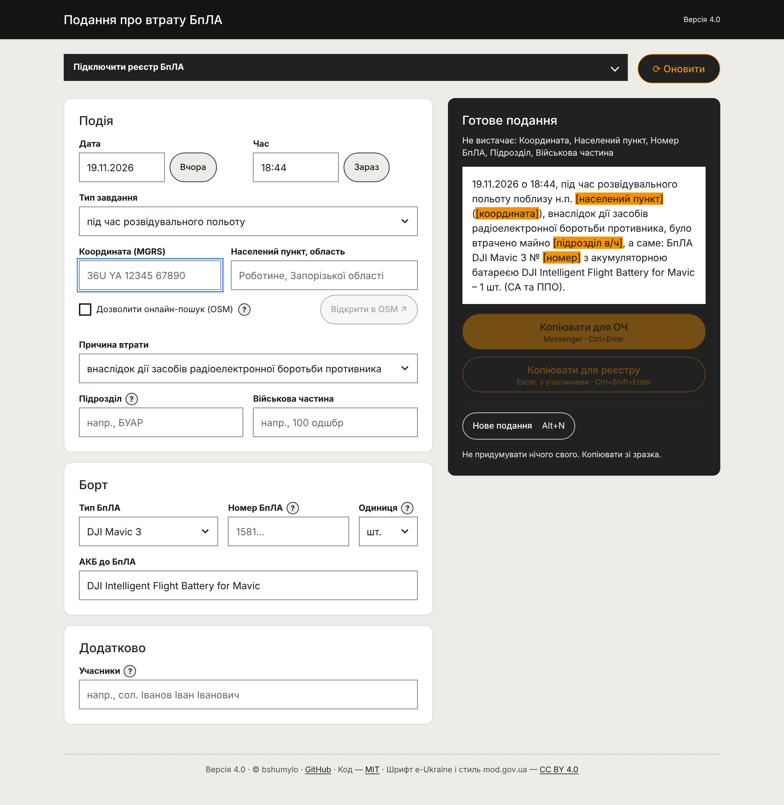

# Генератор подання про втрату БпЛА

Версія 4.0.

Програма складає текст подання про втрату безпілотного літального апарата (БпЛА). Ви заповнюєте поля форми. Текст подання з'являється наживо. Ви копіюєте його однією кнопкою.

## Два режими роботи

- **Просто генератор.** Потрібен лише файл `Подання.html`. Ви вводите тип, номер БпЛА й інші поля вручну.
- **Генератор + реєстр обліку.** Додатково ви підключаєте файл реєстру (`Реєстр БПЛА.xlsm`). Тоді моделі й номери беруться зі списку. Одиниця й АКБ підставляються самі. У списку лишаються лише ті БпЛА, які ще не втрачені. Готовий шаблон реєстру лежить у репозиторії: `Реєстр БПЛА (шаблон).xlsm`.

## Як запустити

1. Відкрийте [останній випуск (Releases)](https://github.com/bshumylo/UAV-Loss-Alert-Generator/releases/latest).
2. Завантажте файл `Podannya.html`. Це і є `Подання.html`.
3. Відкрийте файл подвійним кліком у браузері (Chrome, Edge, Firefox та інші).

Більше нічого встановлювати не треба.

- Програма працює офлайн. Один файл містить усе потрібне.
- База населених пунктів уже вбудована: 14 615 записів.
- Інтернет потрібен лише для онлайн-пошуку населеного пункту. Цей пошук вимкнений за замовчуванням.

## Як користуватися

1. Заповніть поля форми.
2. Перевірте текст у блоці **«Готове подання»**.
3. Натисніть одну з кнопок копіювання.
4. Натисніть **«Нове подання»**, щоб почати наступний запис.

### Блок «Подія»

| Поле | Що вводити |
|---|---|
| **Дата** | Формат дд.мм.рррр. Маска додає крапки сама. Кнопка «Вчора» ставить вчорашню дату. За замовчуванням стоїть сьогоднішня дата. |
| **Час** | Формат гг:хх. Кнопка «Зараз» ставить поточний час. |
| **Тип завдання** | Вибір зі списку: розвідувальний політ, бойовий виліт, нанесення бойового ураження, політ для ураження живої сили противника. |
| **Координата (MGRS)** | Наприклад `36U YA 12345 67890`. Програма сама знаходить населений пункт і область. |
| **Населений пункт, область** | Заповнюється автоматично. Після автопошуку поле закрите. Кнопка «Змінити» відкриває його для ручного вводу. |
| **Причина втрати** | РЕБ, обстріл зі стрілецької зброї, ППО, удар ворожого FPV-дрона. |
| **Підрозділ**, **Військова частина** | Вводяться один раз. Браузер їх запам'ятовує. |

### Блок «Борт»

| Поле | Що вводити |
|---|---|
| **Тип БпЛА** | Вибір зі списку. З реєстром список містить моделі з реєстру. |
| **Номер БпЛА** | Номер з бокса. З реєстром поле показує випадний список номерів цієї моделі. |
| **Одиниця** | шт., од. або к-т. Підставляється автоматично. Підказка «?» пояснює правило. |
| **АКБ до БпЛА** | Підставляється автоматично (див. нижче). |

### Блок «Додатково»

- **Учасники.** Поле не обов'язкове. У текст для ОЧ учасники не входять. Вони додаються окремим рядком лише в копії для реєстру.

### Готове подання

- Рядок стану показує, чого не вистачає. Коли все є, з'являється позначка «Готово до копіювання».
- Обов'язкові поля: дата, час, координата (у правильному форматі), населений пункт, номер БпЛА, підрозділ, військова частина.
- Кнопки копіювання не діють, доки не заповнено все. Якщо натиснути гарячу клавішу раніше, програма покаже, чого не вистачає, й перейде до першого порожнього поля.
- **Копіювати для ОЧ** (Ctrl+Enter) копіює чистий текст подання. Це текст для месенджера.
- **Копіювати для реєстру** (Ctrl+Shift+Enter) копіює той самий текст і рядок `Учасники: …`. Це текст для Excel.
- **Нове подання** (Alt+N) очищає форму. Дата й час стають поточними. Підрозділ і військова частина лишаються.

Приклад тексту (тестові дані):

> 19.11.2026 о 18:44, під час розвідувального польоту поблизу н.п. РОБОТИНЕ, Запорізької області (36U YA 12345 67890), внаслідок дії засобів радіоелектронної боротьби противника, було втрачено майно БУАР 100 одшбр, а саме: БпЛА DJI Mavic 3 № 1581… з акумуляторною батареєю DJI Intelligent Flight Battery for Mavic – 1 шт. (СА та ППО).

## Гарячі клавіші

| Клавіші | Дія |
|---|---|
| Ctrl+Enter | Копіювати для ОЧ |
| Ctrl+Shift+Enter | Копіювати для реєстру |
| Alt+N | Нове подання |
| Esc | Закрити відкриту підказку «?» |

## Координата й населений пункт

- Формат MGRS: зони 35, 36, 37 і смуги T, U, V.
- Цифр має бути порівну з обох боків (від 1 до 5 з кожного боку).
- Кириличні літери, схожі на латинські (А, В, Е, К, М, Н, О, Р, С, Т, Х), розпізнаються правильно.
- Для іншої зони програма показує попередження.
- Спочатку програма шукає найближчий населений пункт у вбудованій базі. Радіус пошуку: 25 км.
- Якщо в радіусі 25 км нічого немає, програма просить ввести населений пункт вручну.
- Онлайн-пошук працює лише після вашої згоди: позначка **«Дозволити онлайн-пошук (OSM)»**. Тоді координата йде в сервіс OpenStreetMap Nominatim. Точність округлюється до ~1 км.
- Кнопка **«Відкрити в OSM ↗»** відкриває карту в новій вкладці. Координата в адресі стоїть після знака `#`, тому на сервер вона не передається.

## АКБ: для яких БпЛА вона підставляється

| БпЛА | АКБ в тексті подання |
|---|---|
| DJI Mavic 3 (усі варіанти) | DJI Intelligent Flight Battery for Mavic |
| DJI Matrice 4 (4Т, 4E) | DJI Matrice 4 Series |
| Autel (4N, 4T, EVO MAX 4T) | для Autel EVO Max |
| Вампір, Кажан, FLYEYE 3.0, Лелека, Shark | АКБ немає. Поле закрите. Фрази про батарею в тексті немає. |
| Інша модель | Поле порожнє. Ви вводите АКБ вручну. Якщо АКБ порожня, фрази про батарею в тексті немає. |

З реєстром АКБ береться також з аркуша `Довідник` (колонка «АКБ за замовчуванням»). Для моделей без батареї це значення не діє.

## Підключення реєстру (не обов'язково)

1. Розгорніть панель **«Підключити реєстр БпЛА»** угорі.
2. Натисніть **«Підключити реєстр…»** і виберіть файл (`.xlsx`, `.xlsm` або `.xlsb`).
3. Заголовок панелі зміниться на **«Реєстр БпЛА підключено»**. Поруч буде дата й кількість БпЛА в наявності.
4. Коли в обліку з'являється нова техніка, натисніть **«⟳ Оновити»**. У Chrome і Edge файл перечитується без нового вибору.
5. Якщо дані старші за 7 днів, програма показує нагадування про оновлення.

Що ще треба знати:

- Файл читається локально. У мережу він не передається.
- Реєстр зберігається в браузері. Файл не змінюється.
- Кнопка **«Очистити збережені дані»** видаляє з браузера реєстр, підрозділ, військову частину та посилання на файл. Користуйтеся нею на чужому або спільному комп'ютері.
- Якщо в файлі немає аркуша `Довідник`, програма показує помилку.

## Реєстр обліку: як влаштований шаблон

Шаблон `Реєстр БПЛА (шаблон).xlsm` має таку ж структуру, як робочий файл. Дані в ньому вигадані (позначка «ПРИКЛАД»). Скопіюйте шаблон, перейменуйте на `Реєстр БПЛА.xlsm` і вносьте свою техніку.

**Аркуші обліку.** Кожен аркуш — це одна група техніки (наприклад, `DJI, Autel`, `Лелека`). Перший рядок містить заголовки. Один БпЛА — один рядок.

Програма знаходить колонки за назвою заголовка:

- **`Модель`**. Якщо колонки немає або клітинка порожня, береться назва аркуша.
- **`Номер`** або заголовок, що починається з **`Борт`**.
- **`Дата втрати`** (заголовок містить слова «дата» і «втрат»).
- **`Од. вим.`** (заголовок починається з «од»).

БпЛА потрапляє у список, якщо виконано всі умови:

- номер заповнений;
- колонка `Дата втрати` порожня (щоб «списати» борт, впишіть дату втрати);
- у рядку немає позначки «немає в обліку» (в жодній колонці).

Програма пропускає аркуші `Довідник`, `Прийом`, `Ящики згоріли`, а також аркуші з назвою, що починається з `_`. Аркуш без колонок «Номер/Борт» і «Дата втрати» теж пропускається.

**Аркуш `Довідник`.** Він зіставляє назви з обліку з назвами для подання.

| Колонка | Зміст |
|---|---|
| A. Модель в обліку | Точно як на аркуші обліку, з усіма помилками. |
| B. Назва для подання | Як модель звучить у поданні. Ця назва потрапляє у список генератора. |
| C. Одиниця | Має пріоритет над одиницею з рядка обліку. |
| D. АКБ за замовчуванням | Текст АКБ для подання. |
| E. Показувати у списку | `ні` ховає позицію (АКБ, антени та інше). |

Кілька рядків можуть вести на одну назву для подання.

**Аркуш `Прийом`.** Він автоматично вносить втрату в реєстр. Потрібен Excel з увімкненими макросами.

1. Вставте текст подання в клітинку A5.
2. Натисніть кнопку **«Записати в реєстр»** (або Alt+F8 → `Прийняти_Подання`).
3. Результат записується в аркуш `Журнал прийому`.

## Приватність і безпека

- Програма не надсилає дані на сервери. Єдиний виняток: онлайн-пошук населеного пункту, який ви вмикаєте самі.
- Браузер дозволяє програмі звертатися лише до `nominatim.openstreetmap.org`.
- У браузері зберігаються: підрозділ, військова частина і дані реєстру. Кнопка «Очистити збережені дані» їх видаляє.
- Використовуйте тестові дані, коли показуєте програму іншим.

## Поради

- Зробіть резервну копію `Подання.html`. Уся програма — це один файл.
- Дані зберігаються лише в браузері на цьому комп'ютері. На іншому пристрої введіть підрозділ і військову частину ще раз та підключіть реєстр.
- Шрифт e-Ukraine береться з вашого комп'ютера, якщо він встановлений. Інакше програма використовує системний шрифт.

## Для розробників

- Уся програма — один файл `Подання.html` без зовнішніх залежностей.
- Вбудовані бібліотеки: SheetJS 0.20.3 і mgrs.js. Скрипт `scripts/check-sheetjs.js` перевіряє, що SheetJS у файлі збігається із закріпленою версією:
  `node scripts/check-sheetjs.js`
- Робочий процес `release.yml` створює новий випуск, коли змінюється `Подання.html` у гілці `main`. До випуску додається файл `Podannya.html`.
- Робочий процес `cleanup-branches.yml` видаляє гілки після злиття.

## Ліцензії

- Код: MIT. Див. [LICENSE](LICENSE).
- Шрифт e-Ukraine і стиль mod.gov.ua: [CC BY 4.0](https://creativecommons.org/licenses/by/4.0/legalcode). Файл шрифту в репозиторії немає.
- Вбудовані бібліотеки: SheetJS (Apache-2.0), mgrs.js (MIT). Повний перелік — у [LICENSE](LICENSE).

Автор: bshumylo
